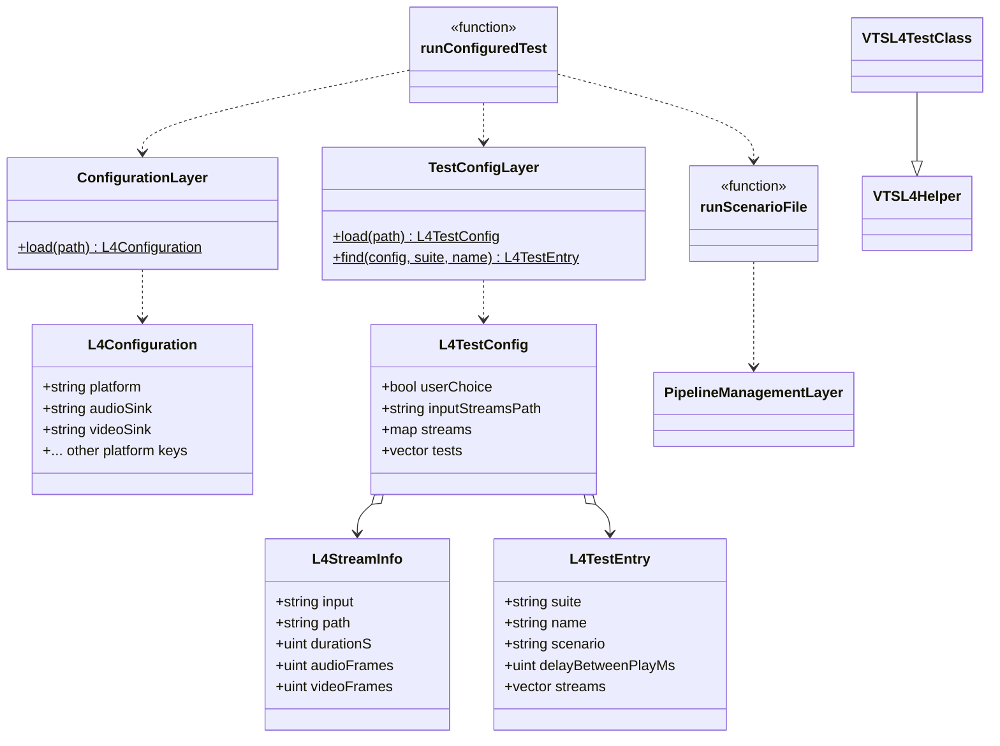
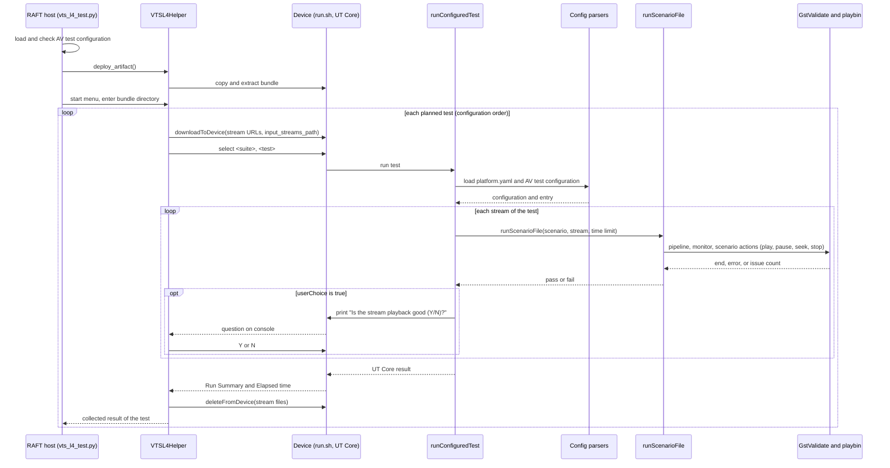

# L4 AV Pipeline Test Framework: Low-Level Design

| Item | Detail |
|---|---|
| Document ID | `L4-AV-DD-001-LLD` |
| Component | `rdk-halif-test-L4-Vendor` (binary `l4-rdk-audio-video`) |
| Version | `0.1` |
| Status | Draft for customer review |
| Author(s) | ShibuThomas |
| Reviewers | Sky Team |
| Date | 19-11-2026 |
| Audience | LTTS team and Sky team |

---

This document holds section 4 (low-level design) of the design document `L4-AV-DD-001`. Section numbers are kept, so references such as section 4.1.5 point here.

---

## 4. Low-level design (LLD)

### 4.1 Component description

#### 4.1.1 Entry point and UT Core
- Files: `src/vts_main.cpp`, `src/vts_audio_video.cpp` (suite classes).
- `main()` calls `UT_init`, runs `UT_run_tests`, and returns the exit status. Suites are registered by `UT_ADD_TEST_TO_GROUP` and `UT_ADD_TEST` at build time.
- Suites: `NormalPlayback`, `PauseResume`, `TrickModes`, `Seek`, `AdaptiveBitrate`, `MetadataPropagation`. Each has tests `Test1` to `Test32`. A test calls `runConfiguredTest(suite, name)`.
- Exit status: `0` all tests passed, `1` at least one failed, `-1` (shown as `255`) UT Core could not start.

#### 4.1.2 Test runner
- Files: `src/vts_audio_video.cpp`, `include/vts_audio_video.h`.
- `runConfiguredTest(suite, name)`:
  1. Loads the platform configuration (`L4_CONFIG` or the compiled default).
  2. Loads the AV test configuration (`L4_TEST_CONFIG` or `av_test_configurations/vts_l4_av_test_config.yaml` in the install base).
  3. Finds the entry `<suite>.<name>`. A missing entry is a failure with a log message.
  4. Checks that the scenario file exists. For each stream of the entry (the host has already downloaded it, section 4.1.7): checks that the stream file exists, runs `runScenarioFile()` with the scenario and a time limit of the stream length plus 120 s, then asks the operator when `userChoice` is true. Waits `delay_between_play` milliseconds.
  5. Logs `PASS` or `FAIL`. The test passes only when every stream passes.

#### 4.1.3 Platform configuration parser
- Files: `include/vts_configuration.h`, `src/vts_configuration.cpp`, `config/platform.yaml`.
- `ConfigurationLayer::load(path)` flattens `platform.yaml` (libfyaml) into dotted keys and fills `L4Configuration`. Every key is required: `media.test_url`, `media.pause_video`, `media.forward_seek_video`, the `elements.*` keys, `playback.*`, and `verification.*`.
- The playback engine uses `elements.audio_sink` and `elements.video_sink` through the platform layer. The other keys are parsed and kept as they were; the current engine does not use them.

#### 4.1.4 AV test configuration and stream configuration parser
- Files: `include/vts_test_config.h`, `src/vts_test_config.cpp`.
- `TestConfigLayer::load(path)`:
  - Resolves relative paths against the install base: the parent of the directory that holds the file.
  - Reads every `include_<n>` file and merges its `AVStreams`. Reads the file's own `AVStreams` next.
  - Reads `AVModule.input_streams_path` and `AVModule.userChoice`.
  - A stream's `input` is a relative path on the stream server and may contain folders (for example `Audio/vts_aac_....mp4`). It is rejected if it starts with `/` or contains `..`. The binary keeps only the file name, so the file is found at `input_streams_path/<file name>`.
  - `AVModule.stream_download_path` is read by the host, not by the binary.
  - `AVModule.scenario_dir` (default `scenarios`) is the folder of the scenario files, relative to the install base.
  - Reads `AVModule.L4.<Suite>.<Test>`: `controls.delay_between_play`, `streams` (stream ids, each of which must exist), and `scenario`. The scenario is taken from the test, or from the suite (`AVModule.L4.<Suite>.scenario`) when the test has none. A scenario name must be a plain file name.
- Checks: a missing key, a malformed value, a test without a scenario, a scenario name that is not a plain file name, an unknown stream id, or an unknown key path raises an error. The runner logs the error and fails the test.
- `TestConfigLayer::find(config, suite, name)` returns the entry or nothing.

#### 4.1.5 Scenario engine
- Files: `src/vts_media_framework.cpp`.
- `runScenarioFile(configuration, scenarioPath, mediaPath, timeoutS)`:
  1. Initializes GStreamer and GstValidate once per process.
  2. Creates the platform pipeline for the media file (`PipelineManagementLayer`).
  3. Attaches a GstValidate monitor to the pipeline.
  4. Creates a GstValidate scenario from the `.scenario` file and attaches it to the pipeline. GstValidate runs the actions (`play`, `pause`, `seek`, `wait`, `stop`).
  5. Sets the pipeline to PLAYING and runs a GLib main loop. The loop ends on EOS, on a pipeline ERROR, or when the pipeline goes to NULL (the scenario's `stop` action).
  6. A watchdog ends the loop after `timeoutS` seconds and fails the run.
  7. Stops the pipeline and asks GstValidate for its issue count. The run passes only if there was no pipeline error, no timeout, and no GstValidate issue.
- Time limit of a stream: its length in the stream configuration plus 120 s.

#### 4.1.6 Platform pipeline layer
- Files: `src/vts_pipeline_management.cpp`, `include/vts_pipeline_management.h`, `include/vts_pipeline_management_interface.h`, `src/vts_<platform>_pipeline_management.cpp`, `src/vts_verification.cpp`.
- `PipelineManagementLayer` checks that the configured `platform:` matches the platform compiled in (case-insensitive substring match), then asks the platform implementation for a playbin pipeline. Audio-only files get the audio sink, video-only files get the video sink, and files with both get both sinks. `MediaStreamDetector` (FFmpeg) detects the streams on platforms that need it.

#### 4.1.7 Python RAFT test host
- Files: `host/tests/TestCases/vts_l4_test.py`, `host/tests/TestCases/vts_l4_helper.py`, `host/tests/TestCases/vts_l4_test_setup.yaml`, `host/tests/configs/vts_deviceConfig.yml`, `host/tests/configs/vts_rack_config.yml`.
- Flow (the same shape as the existing VTS suites):
  1. Read the AV test configuration and its stream configuration from the repository (`load_test_config`). Reject unknown suites, test names outside `Test1` to `Test32`, unknown actions, and unknown stream ids.
  2. Build the run plan: the configured tests of the suites listed in `suites` in the setup file, in configuration order.
  3. Deploy the bundle archive to `target_directory` and extract it there (`/opt/l4-rdk-audio-video`).
  4. Change into the bundle directory and start the UT Core menu (`./run.sh`).
  5. For each planned test: download its stream files with `downloadToDevice` (URL = `stream_download_path` + `AVStreams.<id>.input`, destination = `input_streams_path`), select `<suite>` and `<test>` in the menu with a timeout from `estimate_wait` (each stream adds `DOWNLOAD_MARGIN_S` seconds), then delete the stream files with `deleteFromDevice`. A failed download fails that test and the run continues.
  6. If the console shows the operator question, answer `Y` or `N` followed by a newline.
  7. Wait for `Run Summary:` and `Elapsed time =`, then collect the result with the RAFT UT helper (`collect_results`). A missing summary or a segmentation fault marks the test failed, and the menu is restarted.
  8. Record each step in the RAFT step log, stop the menu, and return the overall verdict.

#### 4.1.8 Bundle
- Files: `arm-deps/make-device-bundle.py`, `config/platform.yaml`, `video-inputs/`.
- Output: `l4-rdk-audio-video.tar.gz`, containing:

```
l4-rdk-audio-video/
├── run.sh                    sets LD_LIBRARY_PATH and L4_CONFIG, then runs the binary
├── bin/l4-rdk-audio-video    stripped test binary
├── lib/                      shared libraries not provided by the device base image
├── etc/platform.yaml         platform configuration, with media paths rewritten to /opt
└── share/video-inputs/       every stream file in the repository
```

- The bundle does not contain `av_test_configurations/` or `scenarios/`. Those files are provisioned on the device, under `/opt/l4-rdk-audio-video/av_test_configurations/`, as section 2.3 states.

### 4.2 Class and data design



#### 4.2.1 AV test configuration (`av_test_configurations/vts_l4_av_test_config.yaml`)

The file is generated from `docs/L4_Test_Cases.md`. Each test case is one `TestN` entry in its suite, in document order. The example is the first NormalPlayback entry.

```yaml
include_0: av_test_configurations/vts_l4_av_stream_config.yaml

AVModule:
  input_streams_path: "assets/streams/input"               # stream directory on the DUT, relative to the install base
  stream_download_path: "http://<stream server>/streams"   # the host downloads from here (not read by the binary)
  scenario_dir: "scenarios"                                # scenario files, relative to the install base
  player: "gstreamer"
  userChoice: true                                         # ask the operator after each stream

  L4:
    NormalPlayback:                                        # suite (use case section 1.0)
      Test1:                                               # test name, Test1 to Test32
        tc_ref: "VTS_L4_H264_AC3_1001"                             # documentation only
        scenario: "NormalPlayback.scenario"                         # GstValidate scenario for this test
        controls:
          delay_between_play: 100                          # ms between streams of this test
        streams:
          - vts_h264_1080p_sdr_60_0f_BT709_yuv420p_8M_ac3_48k_6ch_512k_a1875_v3600_60sec                                   # stream id from AVStreams
```

| Key | Required | Rule |
|---|---|---|
| `AVModule.input_streams_path` | Yes | Directory of the stream files on the DUT, relative to the install base |
| `AVModule.stream_download_path` | Yes | Stream server URL. The host downloads each stream from `<URL>/<input>` |
| `AVModule.scenario_dir` | No | Folder of the scenario files, relative to the install base; default `scenarios` |
| `AVModule.userChoice` | No | `true` or `false`; default `true` |
| `AVModule.L4.<Suite>` | Yes | `<Suite>` is one of the six suite names |
| `AVModule.L4.<Suite>.scenario` | No | Scenario of every test in the suite |
| `<Test>` | Yes | `Test1` to `Test32` |
| `<Test>.scenario` | Yes, unless the suite has one | Scenario of this test; overrides the suite |
| `tc_ref` | No | Test case ID from `docs/L4_Test_Cases.md`. Documentation only |
| `controls.delay_between_play` | No | Non-negative integer (ms); default 0 |
| `streams` | Yes | Non-empty list of stream ids that exist in `AVStreams` |

Current content: 85 test cases in the suites NormalPlayback (21), PauseResume (13), TrickModes (13), Seek (26), AdaptiveBitrate (5) and MetadataPropagation (7). The Seek tests use `SeekForward.scenario` (section 4) or `SeekBackward.scenario` (section 5). Other scenarios are placeholders (section 4.2.4).

#### 4.2.2 Stream configuration (`av_test_configurations/vts_l4_av_stream_config.yaml`)

The file has 37 streams. Each stream id is derived from its file name. The names come from the test case document: 16 match the Polaris stream paths exactly. The other 21 use the document name and are marked `TO CONFIRM` until Sky confirms them (see `docs/L4_Stream_Mapping.md`).

```yaml
AVStreams:
  vts_h264_1080p_sdr_60_0f_BT709_yuv420p_8M_ac3_48k_6ch_512k_a1875_v3600_60sec:
    input: "Audio_Video/HD/vts_h264_1080p_sdr_60.0f_BT709_yuv420p_8M_ac3_48k_6ch_512k_a1875_v3600_60sec.mp4"    # relative path on the stream server; the file is stored under its file name
    duration: 60                      # seconds
    audio_frames: 1875
    video_frames: 3600
    audio_error_frames: 0
    video_error_frames: 0
```

#### 4.2.3 Platform configuration keys used by the test

| Key | Used by | Effect |
|---|---|---|
| `platform` | `PipelineManagementLayer` | Must match the platform compiled in |
| `elements.audio_sink`, `elements.video_sink` | Platform pipeline | Sinks of the playbin |
| Other keys | Parsed only | Kept unchanged (section 4.1.3) |

#### 4.2.4 Scenario files (`scenarios/*.scenario`)

A scenario is a GstValidate script. The engine reads it from `scenario_dir` on the DUT. Each line is one action with `key=value` parameters:

| Action | Parameters | Effect |
|---|---|---|
| `description` | `handles-states`, `need-clock-sync`, `seek` | Header; declares the scenario capabilities |
| `play` | `playback-time` | Start or resume playback at the given time |
| `pause` | `playback-time`, `duration` | Pause at the given time for the duration |
| `seek` | `name`, `playback-time`, `start`, `flags` | Seek to `start` (absolute time in seconds) at the given time, with `accurate+flush` |
| `wait` | `duration` | Do nothing for the duration |
| `stop` | `playback-time` | Stop the pipeline |

Example (`scenarios/PauseResume.scenario`):

```
description, handles-states=true, need-clock-sync=true
play, playback-time=0.0
pause, playback-time=5.0, duration=5.0
play, playback-time=10.0
stop, playback-time=15.0
```

Status of the scenario files:

| File | Status | What it does |
|---|---|---|
| `NormalPlayback.scenario` | Placeholder | Plays to the end |
| `PauseResume.scenario` | Written | Pauses at 5 s for 5 s, stops at 15 s |
| `TrickModes.scenario` | Placeholder | Plays to the end; fast-forward and rewind steps still to be written |
| `SeekForward.scenario` | Written | Seeks forward to 30 s at 5 s, stops at 10 s |
| `SeekBackward.scenario` | Written | Seeks back to 2 s at 5 s, stops at 10 s |
| `AdaptiveBitrate.scenario` | Placeholder | Plays to the end; stream switching still to be written |
| `MetadataPropagation.scenario` | Placeholder | Plays to the end; metadata checks are not implemented |

A placeholder shows only that the stream plays to the end. It does not test the operation of its test case. The files are described in `scenarios/README.md`.

### 4.3 Sequence of a typical run



### 4.4 Result and validation

#### 4.4.1 Reporting path
- The binary reports each test through UT Core: its log lines, its PASS or FAIL assertion, and the `Run Summary:` at the end.
- The host reads that console output with the same RAFT UT helper the existing VTS suites use (`collect_results`).

#### 4.4.2 Pass criteria
A test passes when, for every stream:
- the host downloaded the stream (a failed download fails the test before the device run);
- the stream file exists;
- the scenario ends (its last action completes, or the stream reaches EOS) without a pipeline ERROR and before the time limit;
- GstValidate reports no issue; and
- when `userChoice` is true, the operator answers `Y`.

### 4.5 Configuration design

| File | Location on the device | Edited by | Keys |
|---|---|---|---|
| `platform.yaml` | `etc/platform.yaml` (bundle) | Integrator (platform), unchanged parser | Section 4.1.3 |
| AV test configuration | `av_test_configurations/vts_l4_av_test_config.yaml` (provisioned) | Test author | Section 4.2.1 |
| Stream configuration | `av_test_configurations/vts_l4_av_stream_config.yaml` (provisioned) | Test author | Section 4.2.2 |

Host configuration:

| File | Key | Effect |
|---|---|---|
| `host/tests/configs/vts_deviceConfig.yml` | `target_directory` | Directory on the device that receives the bundle (`/opt`) |
| | `prompt` | Console prompt used by RAFT |
| | `wait_time` | Not used by the current host |
| `host/tests/TestCases/vts_l4_test_setup.yaml` | `suites` | Suites to run, in order. Each must be one of the six suite names |
| | `test.artifacts` | Bundle archive (`build-arm/device/l4-rdk-audio-video.tar.gz`) |
| | `test.execute` | `./run.sh` |

Environment overrides on the device: `L4_CONFIG` (platform configuration) and `L4_TEST_CONFIG` (AV test configuration).

### 4.6 Error handling

| Condition | Where detected | Behaviour | Reported as |
|---|---|---|---|
| AV test configuration invalid (rules in 4.2.1) | Host, before the device run | Run stops | `AV test configuration error: ...` |
| Bundle archive missing | Host | Run stops | `Artifact not found` |
| Platform configuration missing or invalid | Binary, per test | Test fails | `platform configuration failed: ...` in UT log |
| AV test configuration missing or invalid on device | Binary, per test | Test fails | `test configuration failed (...)` in UT log |
| Test not defined in the configuration | Binary | Test fails | `<suite>.<test> is not defined in ...` |
| Stream file missing on device | Binary, per stream | Test fails | `stream file not found` |
| Stream download fails (`downloadToDevice`) | Host, before the test | Test fails; the run continues | `Failed to download streams` in host log |
| Stream download URL missing (`stream_download_path`) | Host, when the configuration is loaded | Run stops | `AV test configuration error` in host log |
| Scenario file not found | Binary, per test | Test fails | `scenario file not found` |
| Scenario name not a plain file name | Binary, when the configuration is loaded | Run stops | `must be a plain scenario file name` |
| Platform mismatch | Pipeline layer | Test fails | Exception message in UT log |
| Pipeline cannot be created | Platform layer | Test fails | `Could not create pipeline` |
| Pipeline ERROR during the scenario | Bus handler | Test fails | `Pipeline error: ...` |
| End of stream during the scenario | Bus handler | Run ends; the verdict comes from GstValidate | `GStreamer Validate reported N issue(s)` if any |
| State change fails | Scenario engine | Test fails | `Failed to set PLAYING` |
| Scenario runs past its time limit (stream length plus 120 s) | Watchdog | Test fails | `Scenario did not finish within its time limit` |
| GstValidate reports an issue | Runner | Test fails | `GStreamer Validate reported N issue(s)` |
| Operator answers `N` or gives no answer | Test runner | Test fails | Host log: operator verdict |
| Binary crashes or hangs | Host | Menu restarted; test fails | `Run Summary not found` |

### 4.7 Logging and diagnostics
- **Binary:** UT Core logs (`UT_LOG`, `UT_LOG_ERROR`) on the console. Each stream logs its file, its expected length and frame counts, and the scenario it runs. Use `run.sh -l <dir>` for a log directory on the device.
- **GStreamer and GstValidate:** their debug output is controlled by `GST_DEBUG`.
- **Host:** RAFT step logs, one step per test, with the suite, test, and streams.

### 4.8 Build, packaging and deployment

Build sequence:
1. CMake lists the sources, selects the platform file from `config/platform.yaml`, and builds `l4-rdk-audio-video`.
2. `arm-deps/make-device-bundle.py <stage-dir> <output-dir>` runs with the ARM SDK environment sourced. It strips the binary, collects its shared libraries, copies the platform configuration and the stream files, writes `run.sh`, and creates the archive.
3. Provision `av_test_configurations/` (the AV test configuration and the stream configuration) and `scenarios/` on the device under the bundle directory.
4. The host test (`vts_l4_test.py`) deploys the archive and runs the suites.

Manual run (without the host):

```bash
mkdir -p /tmp/l4-results
/opt/l4-rdk-audio-video/run.sh -l /tmp/l4-results
```

The command runs the UT Core menu. Select a suite and a test there, as the host does. Running one test from the command line is not documented here; confirm the UT Core option on the device before scripting it.

Exit status: `0` all tests passed, `1` a test failed, `255` UT Core did not start.

---
