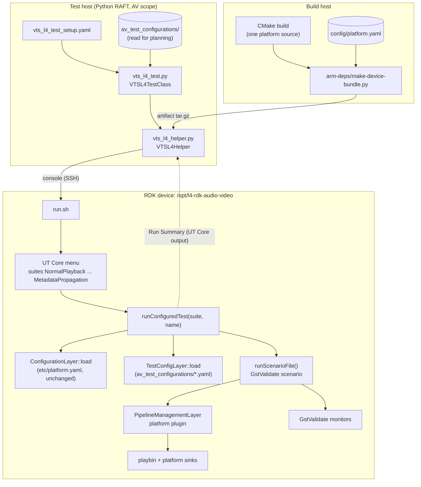

# L4 AV Pipeline Test Framework: Design Document

| Item | Detail |
|---|---|
| Document ID | `L4-AV-DD-001` |
| Component | `rdk-halif-test-L4-Vendor` (binary `l4-rdk-audio-video`) |
| Version | `0.1` |
| Status | Draft for customer review |
| Author(s) | ShibuThomas |
| Reviewers | Sky Team |
| Date | 19-11-2026 |
| Audience | LTTS team and Sky team |

---

## 1. Introduction

### 1.1 Purpose
This document describes the L4 Audio-Video (AV) pipeline test framework: how a test is defined, how the Python RAFT host runs it on a device, how the device binary parses its configuration and plays the stream, and how results are reported. After reading it, an integration engineer should be able to add a test to the configuration, select suites from the host, and understand what the framework verifies today and what it does not.

### 1.2 Scope
- In scope:
  - Playback validation on RDK devices for the Amlogic, Broadcom, and Realtek platforms.
  - Six UT Core suites, one per use case of `docs/L4_Test_Cases.md`: NormalPlayback, PauseResume, TrickModes, Seek, AdaptiveBitrate, and MetadataPropagation.
  - The platform configuration, the AV test configuration, the stream configuration, the device binary, the bundle, and the Python RAFT host.
- Out of scope:
  - Other HAL domains, which are tested by other RAFT modules.
  - Audio and video quality metrics beyond what GstValidate reports and the operator verdict.

### 1.3 Terms and abbreviations

| Term | Meaning |
|---|---|
| AV | Audio-Video |
| Platform configuration | `config/platform.yaml` (device: `etc/platform.yaml`). Platform name, elements, sinks, and verification keys. Parsed by `ConfigurationLayer::load` |
| AV test configuration | `av_test_configurations/vts_l4_av_test_config.yaml`. Suites, tests, scenario names, streams, and the operator-verdict switch. Parsed by `TestConfigLayer::load` |
| Stream configuration | `av_test_configurations/vts_l4_av_stream_config.yaml` (`AVStreams`). Stream files and their expected lengths and frame counts. Included from the AV test configuration with `include_<n>` |
| Scenario file | A GstValidate scenario (`.scenario`) that a test runs on the pipeline: play, pause, seek, wait, and stop. Read from `scenario_dir` on the DUT |
| Suite | A UT Core suite, one per use case, for example `NormalPlayback` |
| Test | A UT Core test inside a suite, named `Test1` to `Test32`. Its entry is found in the AV test configuration |
| GstValidate | GStreamer validation framework. Attaches monitors to the pipeline and reports issues |
| playbin | GStreamer high-level playback element |
| UT Core | Unit-test framework that registers suites and tests, runs them, and prints the run summary |
| RAFT | Python test framework that connects to devices, deploys artifacts, runs tests, and collects results |
| Bundle | Self-contained tar.gz for the device, built by `arm-deps/make-device-bundle.py` |
| EOS | End of stream |
| TC ID | Test case identifier in `docs/L4_Test_Cases.md` |

### 1.4 References
- [L4 Test Cases](L4_Test_Cases.md): test case specification and TC IDs.
- [L4 Build Steps](L4_Build_Steps.md): build and manual run instructions.
- [L4 Stream Mapping](L4_Stream_Mapping.md): test case to stream mapping, with the streams Sky must confirm.
- `config/platform.yaml`, `av_test_configurations/*.yaml`, `scenarios/*.scenario`: runtime inputs.
- `CMakeLists.txt`, `arm-deps/make-device-bundle.py`: build inputs.

---

## 2. Requirements

### 2.1 Functional requirements

The functional requirements are derived from the use cases in [L4 Test Cases](L4_Test_Cases.md). Requirements FR-01 to FR-20 are the playback use cases, one requirement per use case group and media type, with the TC IDs they cover. Requirements FR-21 to FR-26 are framework requirements.

The **Coverage** column shows what the code implements today:

- **Configured (placeholder)**: the test case is in the AV test configuration with its stream. Its scenario file is a placeholder that plays the stream to the end. The operation in the test case is not written yet (LLD section 4.2.4).
- **Engine supported**: the scenario engine can run this kind of scenario, but no test is configured for it yet.
- **Not implemented**: the requirement needs a validator or a capability that does not exist yet.

Pass criteria for each use case are the metrics in the "Metrics to be validated" and "Gst-validate-launcher Metrics" sections of [L4 Test Cases](L4_Test_Cases.md). The current pass criteria are described in LLD section 4.4.2.

#### 2.1.1 AV playback (test case section 1.0)

| ID | Test cases | Priority | Coverage |
|---|---|---|---|
| FR-01 | `VTS_L4_H264_AC3_1001`, `VTS_L4_H265_EAC3_1001`, `VTS_L4_MPEG2_AAC_1001`, `VTS_L4_VP9_AAC_1001`, `VTS_L4_AV1_AAC_1001`, `VTS_L4_H264_AC3_1001_01`, `VTS_L4_H265_EAC3_1001_01` | Must | Configured (placeholder scenario); operation not written yet |
| FR-02 | `VTS_L4_AAC_1201`, `VTS_L4_AC3_1201`, `VTS_L4_EAC3_1201`, `VTS_L4_EAC3_ATMOS_1201`, `VTS_L4_PCM_1201`, `VTS_L4_OPUS_1201`, `VTS_L4_VORBIS_1201`, `VTS_L4_FLAC_1201`, `VTS_L4_MP3_1201` | Must | Configured (placeholder scenario); operation not written yet |
| FR-03 | `VTS_L4_H264_1501`, `VTS_L4_HEVC_1501`, `VTS_L4_HEVC_1502`, `VTS_L4_VP9_1501`, `VTS_L4_AV1_1501` | Must | Configured (placeholder scenario); operation not written yet |

#### 2.1.2 Pause and resume (test case section 2.0)

| ID | Test cases | Priority | Coverage |
|---|---|---|---|
| FR-04 | `VTS_L4_H264_AAC_7001`, `VTS_L4_H264_AC3_7001`, `VTS_L4_H265_EAC3_7001`, `VTS_L4_VP9_OPUS_7001`, `VTS_L4_AV1_AC3_7001` | Must | Configured (`PauseResume.scenario` written) |
| FR-05 | `VTS_L4_AAC_1301`, `VTS_L4_AC3_1301`, `VTS_L4_EAC3_1301` | Must | Configured (placeholder scenario); operation not written yet |
| FR-06 | `VTS_L4_H264_1601`, `VTS_L4_HEVC_1601`, `VTS_L4_HEVC_1602`, `VTS_L4_VP9_1601`, `VTS_L4_AV1_1601` | Must | Configured (placeholder scenario); operation not written yet |

#### 2.1.3 Trick modes: fast-forward and rewind (test case section 3.0)

| ID | Test cases | Priority | Coverage |
|---|---|---|---|
| FR-07 | `VTS_L4_H264_AAC_7001_01`, `VTS_L4_H264_AC3_7001_01`, `VTS_L4_H265_EAC3_7001_01`, `VTS_L4_VP9_OPUS_7001_01`, `VTS_L4_AV1_AC3_7001_01` | Must | Configured (placeholder scenario); operation not written yet |
| FR-08 | `VTS_L4_AAC_1301_01`, `VTS_L4_AC3_1301_01`, `VTS_L4_EAC3_1301_01` | Must | Configured (placeholder scenario); operation not written yet |
| FR-09 | `VTS_L4_H264_1601_01`, `VTS_L4_HEVC_1601_01`, `VTS_L4_HEVC_1602_01`, `VTS_L4_VP9_1601_01`, `VTS_L4_AV1_1601_01` | Must | Configured (placeholder scenario); operation not written yet |

#### 2.1.4 Forward seek (test case section 4.0)

| ID | Test cases | Priority | Coverage |
|---|---|---|---|
| FR-10 | `VTS_L4_H264_AAC_7001_02`, `VTS_L4_H264_AC3_7001_02`, `VTS_L4_H265_EAC3_7001_02`, `VTS_L4_VP9_OPUS_7001_02`, `VTS_L4_AV1_AC3_7001_02` | Must | Configured (`SeekForward.scenario` written) |
| FR-11 | `VTS_L4_AAC_1301_02`, `VTS_L4_AC3_1301_02`, `VTS_L4_EAC3_1301_02` | Must | Configured (placeholder scenario); operation not written yet |
| FR-12 | `VTS_L4_H264_1601_02`, `VTS_L4_HEVC_1601_02`, `VTS_L4_HEVC_1602_02`, `VTS_L4_VP9_1601_02`, `VTS_L4_AV1_1601_02` | Must | Configured (placeholder scenario); operation not written yet |

#### 2.1.5 Backward seek (test case section 5.0)

| ID | Test cases | Priority | Coverage |
|---|---|---|---|
| FR-13 | `VTS_L4_H264_AAC_7001_03`, `VTS_L4_H264_AC3_7001_03`, `VTS_L4_H265_EAC3_7001_03`, `VTS_L4_VP9_OPUS_7001_03`, `VTS_L4_AV1_AC3_7001_03` | Must | Configured (`SeekBackward.scenario` written) |
| FR-14 | `VTS_L4_AAC_1301_03`, `VTS_L4_AC3_1301_03`, `VTS_L4_EAC3_1301_03` | Must | Configured (placeholder scenario); operation not written yet |
| FR-15 | `VTS_L4_H264_1601_03`, `VTS_L4_HEVC_1601_03`, `VTS_L4_HEVC_1602_03`, `VTS_L4_VP9_1601_03`, `VTS_L4_AV1_1601_03` | Must | Configured (placeholder scenario); operation not written yet |

#### 2.1.6 Adaptive bitrate resolution switching (test case section 6.0)

| ID | Test cases | Priority | Coverage |
|---|---|---|---|
| FR-16 | `VTS_L4_H264_AAC_6001_01`, `VTS_L4_H265_EAC3_6001_01`, `VTS_L4_VP9_OPUS_6001_01` | Must | Configured (placeholder scenario); operation not written yet |
| FR-17 | `VTS_L4_H264_AAC_6002_02`, `VTS_L4_H265_EAC3_6002_02` | Must | Configured (placeholder scenario); operation not written yet |

#### 2.1.7 Metadata propagation (test case section 7.0)

| ID | Test cases | Priority | Coverage |
|---|---|---|---|
| FR-18 | `VTS_L4_HDR10_2001`, `VTS_L4_HDR10P_2001`, `VTS_L4_HLG_2001`, `VTS_L4_SDR_2001`, `VTS_L4_DVISION_2001` | Must | Configured (placeholder); caps validator not implemented |
| FR-19 | `VTS_L4_META_FIELDS_2001` | Must | Configured (placeholder); caps validator not implemented |
| FR-20 | `VTS_L4_META_CONSISTENCY_2001` | Must | Configured (placeholder); caps validator not implemented |

#### 2.1.8 Framework requirements

| ID | Priority | Requirement | Verified by | Coverage |
|---|---|---|---|---|
| FR-21 | Must | Tests are defined in the AV test configuration, not in C++. Adding a test to an existing suite needs only a configuration change. | LLD section 4.2.1 | Implemented (the suite must already exist; a new suite needs code, see section 5.1) |
| FR-22 | Must | The RAFT host copies each test's streams to the device before the test and deletes them afterwards. | LLD section 4.1.7 | Implemented |
| FR-23 | Must | The platform configuration (`platform.yaml`) and its parser stay unchanged. | LLD sections 4.1.3, 4.1.4 | Implemented |
| FR-24 | Must | The configuration says what to play, and C++ says how to play and validate (design approach in section 3.1). | Section 3.1 | Implemented |
| FR-25 | Should | Stream inputs are relative paths that may include folders. The binary finds each file by its file name under the input streams folder. | LLD section 4.1.4 | Implemented |
| FR-26 | Must | Results are reported through the same path as the existing VTS suites, with one test run at a time through the UT Core menu. | LLD section 4.3 | Implemented |

### 2.2 Non-functional requirements

| ID | Category | Requirement |
|---|---|---|
| NFR-01 | Scalability | Test count and stream count shall grow without changes to the host test code or the binary. |
| NFR-02 | Maintainability | Each test's expectations are readable in the AV test configuration, and its playback script in one scenario file. |
| NFR-03 | Portability | The framework shall build for each platform from the same source tree, selected by `platform:` in `config/platform.yaml`. |
| NFR-04 | Reproducibility | All host inputs shall come from this repository. Device inputs (the AV test configuration and stream configuration) shall be provisioned from the same files. |
| NFR-05 | Fail-fast | Invalid test configuration entries shall be reported before a device run starts, where the host can check them. |
| NFR-06 | Timeouts | Every test shall have a bounded run time derived from its stream length (the scenario watchdog and the host wait). |

### 2.3 Constraints and assumptions
- Target runtime: RDK device with GStreamer, the GstValidate library, and the platform's playbin sinks installed.
- Build host: CMake 3.18 or later, GStreamer and GstValidate development packages, FFmpeg, libfyaml, and GoogleTest. CMake still requires libcurl, but the binary does not use it: the host downloads the streams. Python 3 with PyYAML is needed by the host and the bundle script.
- Cross-compilation: the ARM SDK environment (`SDKTARGETSYSROOT`) must be sourced before the bundle is built.
- The Python host uses the RAFT framework (`python_raft`, `ut-raft`, `rdk_raft`), an external dependency pinned in `build_dependencies.sh` of the unified VTS repository.
- **The AV test configuration and the stream configuration are provisioned on the device** under `<install base>/av_test_configurations/`. The bundle does not carry them, and the host does not copy them. The host reads the same files from the repository only to plan the run.
- Stream files are downloaded to the DUT by the host (RAFT `downloadToDevice`), from `AVModule.stream_download_path` plus each stream's relative path, into `AVModule.input_streams_path`. They are deleted after each test. The bundle's `video-inputs/` is kept as it is.
- Scenario files (`scenarios/*.scenario`) must be on the DUT under the install base, in the folder named by `AVModule.scenario_dir`.
- The device binary runs one test at a time.

---

## 3. Architecture overview

### 3.1 Design approach

| Decision | Chosen approach | Alternatives considered | Reason |
|---|---|---|---|
| D-01 Separate what from how | Tests are described in the AV test configuration (what to play and in which order). C++ implements how to play and validate | Hard-code each test in C++ | Tests change without a code change (FR-21) |
| D-02 Test definition | Suite and test entries in the AV test configuration (`AVModule.L4.<Suite>.<Test>`) with `streams`, `controls`, and a `scenario` key | Flat layout with a separate suite field | Mirrors the suites; one key path per test |
| D-03 Platform configuration | Unchanged parser and file (`platform.yaml`) | Merge with the test configuration | The platform parser is kept as it was (FR-23) |
| D-04 Suite and test registration | UT Core suites per use case; tests `Test1` to `Test32` registered at build time; a test runs the configuration entry with its suite and name | Register tests from the configuration at run time | UT Core registers tests at build time; a fixed name range keeps the menu stable |
| D-05 Playback control | Each test runs a GstValidate scenario file on the platform pipeline. The scenario is read on the DUT at run time | Hand-written GLib timers and seeks per test (earlier design) | Scripts are data; GstValidate provides the actions and monitors |
| D-06 Host orchestration | Python RAFT test scoped to AV suites; runs one test at a time through the UT Core menu | Run the binary once for all tests | Same result path as the existing VTS suites (FR-26) |
| D-07 Packaging | One bundle with binary, libraries, platform configuration, and stream files | Install into system directories | The device needs no development packages; paths are fixed relative to the bundle |

### 3.2 High-level design (HLD)

| Layer | Owner | Responsibility |
|---|---|---|
| Test configuration | Test author | Defines each test's scenario and streams, and the operator-verdict switch |
| Stream configuration | Test author | Defines stream files, expected length, and frame counts |
| Platform configuration | Integrator | Platform identity, sinks, media paths, verification keys |
| UT Core suites and tests | Framework (C++) | Registers the use-case suites and `Test1` to `Test32`; reports each result |
| Test configuration parser | Framework (C++) | Parses and checks the AV test and stream configuration |
| Scenario engine | Framework (C++) | Runs the scenario on the platform pipeline and decides pass or fail |
| Platform pipeline | Platform team (C++) | Builds the playbin pipeline and sinks for one SoC |
| Verification | GstValidate | Attaches monitors; its issue count is part of the result |
| Orchestration | Python RAFT (AV scope) | Deploys the bundle, runs each test through the menu, answers the operator prompt, collects results |

## 4. Low-level design (LLD)

The low-level design is in a separate document: [L4 AV Low-Level Design](L4_AV_Low_Level_Design.md). Its sections keep the numbers 4.x, for example LLD section 4.1.5 (scenario engine) and LLD section 4.2.1 (AV test configuration).

## 5. Extensibility and maintenance

### 5.1 What requires a code change

| Change | Files | Reason |
|---|---|---|
| New suite | `src/vts_audio_video.cpp`, `vts_l4_test.py` (`KNOWN_SUITES`) | Suites are registered at build time |
| New GstValidate action in a scenario | None. Scenario files only | GstValidate parses and runs the actions |
| New validator or metadata check | `src/vts_media_framework.cpp`, `src/vts_verification.cpp` | Current pass criteria are in LLD section 4.4.2 |
| New platform | `src/vts_<platform>_pipeline_management.cpp`, `config/platform.yaml`, `CMakeLists.txt` | Each platform supplies its own pipeline |
| New platform configuration key | `include/vts_configuration.h`, `src/vts_configuration.cpp`, `config/platform.yaml` | Keys are read explicitly |

---

## 6. Performance and resource considerations
- **Timeouts.** The scenario watchdog is the stream length plus 120 s. The host estimates each test's wait from its streams, a 60 s margin, and 60 s per stream for the download. The download is not in the binary's watchdog.
- **Serial execution.** Tests run one after another on one device, each as a menu selection. The GstValidate runner is created once per process.
- **Storage.** The bundle carries every stream file in `video-inputs/`. Reduce it to the files the configuration uses.
- **Memory.** Each stream creates and releases its own pipeline.

---

## 7. Revision history

| Version | Date | Author | Change |
|---|---|---|---|
| 0.1 | 19-11-2026 | ShibuThomas | Initial customer draft |

---

## 8. Approvals

| Role | Name | Signature / date |
|---|---|---|
| Design owner | Shibu Thomas | |
| Reviewer | Sky team | |
| Customer acceptance | Sky Team | |
