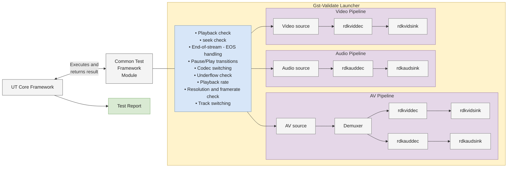
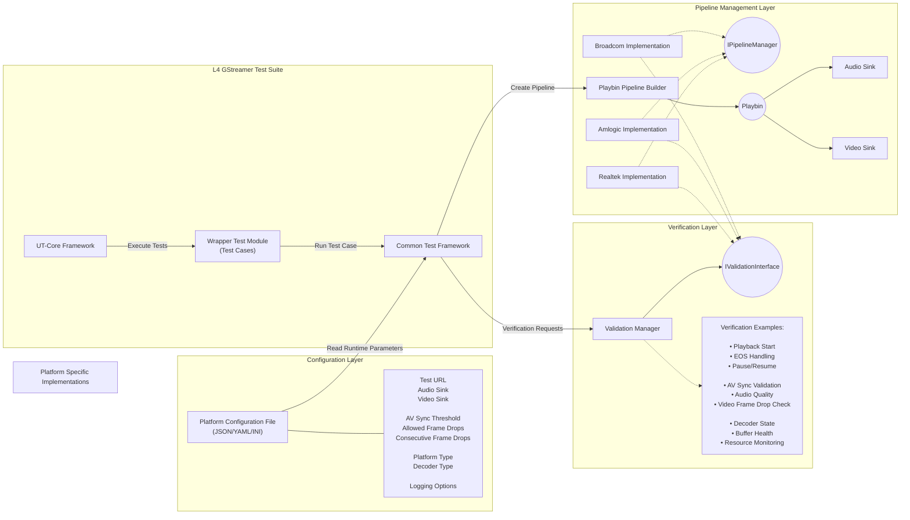

# L4 AV VTS Test Framework

The AV VTS Test Framework is composed of the following:
- UT Core-based Test Framework
- Platform agnostic architecture
- Reusable framework for all test cases
- GstValidate-based pipeline validation
- YAML driven configuration
- Timestamp anomaly detection

### Features

#### Platform Abstraction
- Platform is selected through YAML configuration
- No platform specific code change required in Framework
- Common testcase definitions

#### GstValidate Monitors & Scenarios

- **GstValidateRunner:** Orchestrates test execution, manages test lifecycle, and aggregates validation results and reports.
- **GstValidateScenario:** Executes validation scenarios such as:
  - Playback
  - Seek
  - Pause
  - Flush
  - EOS handling
- **GstValidateMonitor:** Monitors pipelines, elements, pads, buffers and events.

#### GST-Validate Integration

GST-Validate is integrated into the AV Test Framework to perform automated validation of GStreamer pipeline behavior during test execution. The framework leverages GST-Validate monitors and validation infrastructure to detect media pipeline anomalies, protocol violations, synchronization issues, and playback errors without requiring explicit validation logic within individual test cases.

## End-to-End Architecture



## HLD - Test Framework



## End-to-End Execution Flow

```mermaid
flowchart TD
    start(( )) --> ut_execute["UT-Core Executes Test"]
    ut_execute --> select_case["Wrapper Test Module Selects Test Case"]
    select_case --> common_framework["Common Test Framework"]
    common_framework --> load_configuration["Load Platform Configuration"]
    configuration_values["Read:<br/>- URL<br/>- AudioSink<br/>- VideoSink<br/>- AV Sync Threshold<br/>- Frame Drop Limits<br/>- Platform Type"]
    load_configuration --- configuration_values
    load_configuration --> create_pipeline["Create Playbin Pipeline"]
    create_pipeline --> configure_audio["Configure Audio Sink"]
    configure_audio --> configure_video["Configure Video Sink"]
    configure_video --> set_playing["Set Pipeline To PLAYING"]
    set_playing --> test_running{"Test Running?"}

    test_running --> collect_metrics["Collect Runtime Metrics"]
    collect_metrics --> invoke_verification["Invoke Common Verification Interface"]
    invoke_verification --> platform_check{"Platform Check Required?"}
    platform_check -->|Yes| platform_implementation["Platform Specific Implementation"]
    platform_implementation --> perform_validation["Perform Validation"]
    platform_check -->|No| validation_merge{" "}
    perform_validation --> validation_merge
    validation_merge --> test_running

    test_running --> compare_thresholds["Compare Against Thresholds"]
    compare_thresholds --> pass_check{"Pass?"}
    pass_check -->|PASS| pass_report["Generate PASS Report"]
    pass_check -->|FAIL| fail_report["Generate FAIL Report"]
    pass_report --> report_merge{" "}
    fail_report --> report_merge
    report_merge --> finish((( )))


