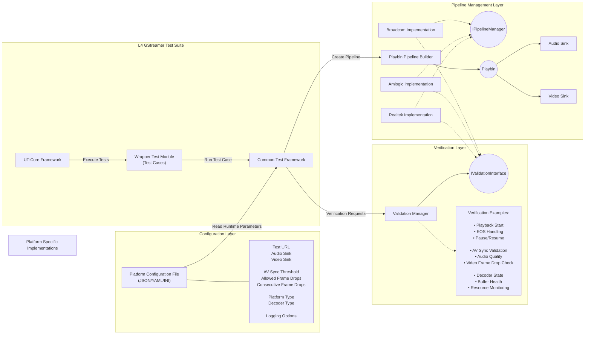
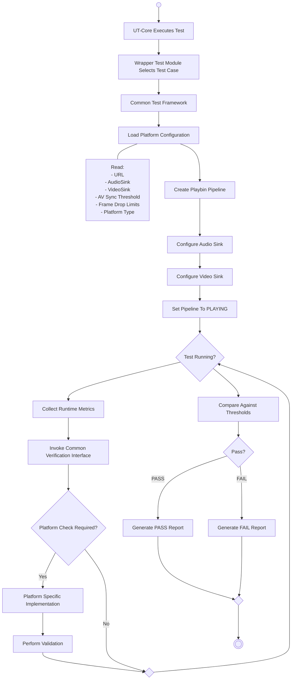

# rdk-halif-test-L4-Vendor: Overview

## 1. Overview

`l4-rdk-audio-video` is a Yocto-built RDK test package for validating GStreamer video pipelines on platform-specific devices.

The package combines:

- UT Core test registration and execution.
- UT Control logging/KVP support.
- INI-based runtime configuration.
- FFmpeg/libavformat codec detection.
- Platform-specific pipeline construction.
- GStreamer and GstValidate scenario execution.
- Timestamp anomaly detection.
- JSON runtime reports.

The current target executable is:

```text
/usr/bin/rdkgstreamerplugin/l4test/l4-rdk-audio-video
```

The design is intended to support additional test groups and platform implementations without moving common dependency or package logic into each test folder.

## 2. Design Goals

The framework is organized around these goals:

1. Keep test registration separate from pipeline construction.
2. Keep platform-specific pipeline decisions outside the common test code.
3. Load runtime paths, element names, sinks, and thresholds from `platform.ini`.
4. Detect the media codec when required by the selected platform pipeline.
5. Reuse the common GstValidate execution and reporting flow.
6. Allow future test folders to be added through child CMake projects.
7. Keep Yocto packaging responsible for supplying the executable, configuration, libraries, and video assets.

## 3. High-Level Architecture



## 4. End-to-End Execution Flow



## 5. Folder Structure

```text
l4-rdk-audio-video/
|-- CMakeLists.txt
|-- l4-rdk-audio-video.bb
|-- README.md
|-- audio-inputs/
|-- meta-layers/
|   |-- meta-rdk-oss-reference/
|   |   `-- recipes-multimedia/ffmpeg/ffmpeg_4.2.%.bbappend
|   `-- meta-rdk-vendor-test-utils/
|       |-- recipes-multimedia/gstreamer/gst-devtools_1.18.5.bb
|       `-- recipes-support/libfyaml/
|           |-- libfyaml_git.bb
|           `-- libfyaml/0001-allocator-durable-skip-pointer-alignment-on-32bit.patch
|-- config/
|   `-- platform.ini
|-- docs/
|   |-- README_Overview.md
|   |-- README_Dependencies.md
|   `-- README_Build_Steps.md
|-- rdk-audio-video-testframework/
|   |-- CMakeLists.txt
|   |-- rdk-AV-UT.cpp
|   |-- include/
|   |   |-- l4-rdk-audio-video.h
|   |   |-- l4_configuration.h
|   |   |-- pipeline_management_interface.h
|   |   |-- pipeline_management_layer.h
|   |   `-- verification_layer.h
|   |-- platforms/
|   |   |-- Amlogic/
|   |   |   `-- src/platform_pipeline_management.cpp
|   |   |-- Broadcom/
|   |   |   `-- src/platform_pipeline_management.cpp
|   |   `-- Realtek/
|   |       `-- src/platform_pipeline_management.cpp
|   `-- src/
|       |-- common_test_framework.cpp
|       |-- configuration_layer.cpp
|       |-- l4-rdk-audio-video.cpp
|       |-- pipeline_management_layer.cpp
|       `-- verification_layer.cpp
`-- video-inputs/
    |-- BigBuckBunny.mp4
    |-- ffmpeg-defective-test.mp4
    |-- negative-jump-test.ts
    |-- duplicate-timestamp-test.ts
    |-- timestamp-continuity-defective.ts
    `-- bigbuck-clean-20s.mp4
```

The parent CMake file is the common build entry point. The `rdk-audio-video-testframework` child CMake file owns the current test executable. Future test groups can be added as sibling folders and registered from the parent with `add_subdirectory(...)`.
