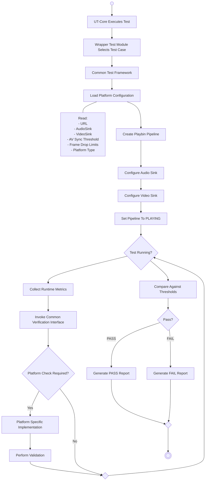

# rdk-halif-test-L4-Vendor: Overview

## 1. Overview

`l4-rdk-audio-video` is a Yocto-built RDK test package for validating GStreamer video pipelines on platform-specific devices.

The package combines:

- UT Core test registration and execution.
- UT Control logging/KVP support.
- INI-based runtime configuration.
- FFmpeg/libavformat codec detection.
- Platform-specific pipeline construction.
- GStreamer and GstValidate scenario execution.
- Timestamp anomaly detection.
- JSON runtime reports.

The current target executable is:

```text
/usr/bin/rdkgstreamerplugin/l4test/l4-rdk-audio-video
```

The design is intended to support additional test groups and platform implementations without moving common dependency or package logic into each test folder.

## 2. GST-Validate Integration

GST-Validate is integrated into the AV Test Framework to perform automated validation of GStreamer pipeline behavior during test execution. The framework leverages GST-Validate monitors and validation infrastructure to detect media pipeline anomalies, protocol violations, synchronization issues, and playback errors without requiring explicit validation logic within individual test cases.

##### Validation Coverage

GST-Validate implicitly monitors and validates the following aspects of a GStreamer pipeline:

| Attribute | Parameters / Metrics Monitored |
|-----------|--------------------------------|
| **Buffer Attributes** | Buffer PTS (Presentation Timestamp)<br>Buffer DTS (Decode Timestamp)<br>Buffer Duration<br>Buffer Offset / Offset End<br>Buffer Sequence / Order<br>Buffer Timestamps Relative to Segment Boundaries |
| **Segment Information** | Segment Start<br>Segment Stop<br>Segment Position<br>Segment Rate<br>Segment Format (TIME, BYTES, etc.)<br>Segment Updates After Seeks |
| **Event Flow** | STREAM_START<br>SEGMENT<br>EOS (End of Stream)<br>FLUSH_START<br>FLUSH_STOP<br>SEEK<br>TAG<br>CAPS<br>LATENCY |
| **CAPS Negotiation** | Media Type<br>Resolution<br>Framerate<br>Pixel Format<br>Sample Rate<br>Channel Count |
| **Pipeline State Transitions** | NULL<br>READY<br>PAUSED<br>PLAYING |
| **Bus Message Monitoring** | ERROR Messages<br>WARNING Messages<br>EOS Messages<br>STATE_CHANGED Messages<br>LATENCY Messages<br>ELEMENT Messages |

> **Note:** GST-Validate implicitly validates the above pipeline parameters and behaviors through its monitoring infrastructure. Validation issues generated by GST-Validate can help identify timestamp inconsistencies, buffer-flow anomalies, event sequencing issues, CAPS negotiation failures, pipeline state transition problems, synchronization issues, and runtime GStreamer errors.


## 3. Design Goals

The framework is organized around these goals:

1. Keep test registration separate from pipeline construction.
2. Keep platform-specific pipeline decisions outside the common test code.
3. Load runtime paths, element names, sinks, and thresholds from `platform.ini`.
4. Detect the media codec when required by the selected platform pipeline.
5. Reuse the common GstValidate execution and reporting flow.
6. Allow future test folders to be added through child CMake projects.
7. Keep Yocto packaging responsible for supplying the executable, configuration, libraries, and video assets.


## 4. End-to-End Execution Flow



The parent CMake file is the common build entry point. The `rdk-audio-video-testframework` child CMake file owns the current test executable. Future test groups can be added as sibling folders and registered from the parent with `add_subdirectory(...)`.
